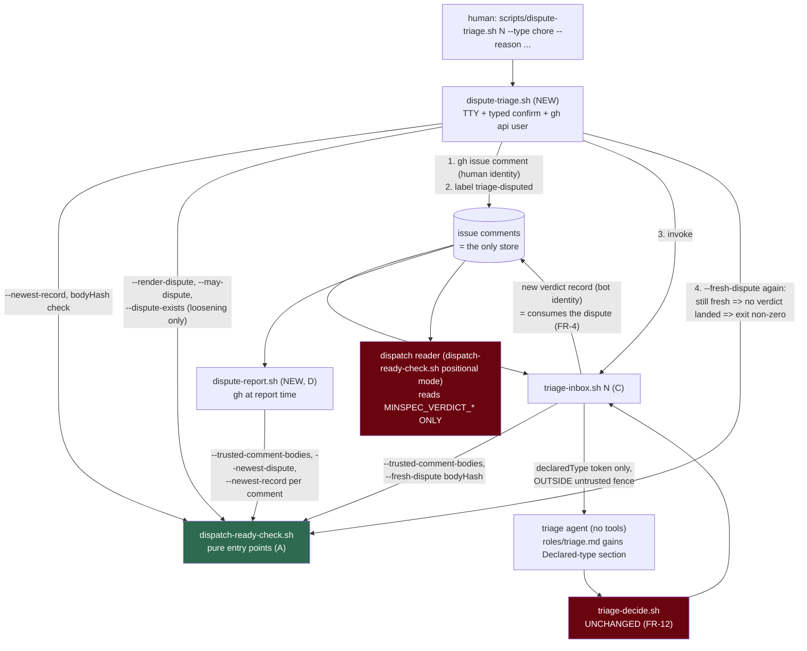

# SPEC-067 - The triage dispute lane (Design)

> Plan artifact for [requirements.md](./requirements.md), which implements
> [DR-091 (the triage dispute lane)](../../../docs/decisions/DR-091.md). Every `file:line`
> below was opened at `67de26a5` (origin/main, 2026-10-17). Where requirements.md cites a
> line that has since drifted (it cites `--may-approve` at `dispatch-ready-check.sh:468-472`;
> it now starts at `:512`), the number here supersedes it. Implementers re-measure at their
> own commit.

## 1. Approach in one paragraph

Everything this lane needs already exists once, in `scripts/dispatch-ready-check.sh`: a
body hasher (`body_hash`, `:214`), a field scrubber (`record_scrub`, `:231`), a
timestamp-ranked block selector (`_newest_record_impl`, `:263`), an author-trust filter
(`--trusted-comment-bodies`, `:457`), a bot-identity test (`is_bot_identity`, `:321`) and a
republication fence (`fence_agent_text`, `:386`). So the design **adds a second record
family to that one file and reuses every one of those primitives**, rather than growing a
parallel reader. The dispute family gets its own sentinels, its own validity predicate and
five pure entry points (C-3). Around that pure core sit three thin consumers: a
credentialed front end that records a dispute and immediately re-triages
(`dispute-triage.sh`, new), a change to `triage-inbox.sh` that injects a fresh dispute's
validated type token into the prompt, and a read-only report (`dispute-report.sh`, new).
`triage-decide.sh` is not touched, and the dispatch reader never learns the new sentinels
exist.

## 2. Architecture



The two red nodes are the load-bearing negatives: the deterministic gate (FR-12) and the
dispatch reader (FR-2, INV-2) must be provably unaffected. The green node is where all
policy lives; every other box asks it.

## 3. Data - the dispute record

The wire schema is requirements.md C-1, unchanged. This table adds what each field is
checked against **at read time**, which C-1 leaves to the plan:

| field | source at write | validity check at read (all must hold, else the block is not selectable) |
|---|---|---|
| `gate` | literal | equals `minspec-triage-dispute/1` |
| `declaredType` | `--type`, scrubbed | member of the C-2 union (one vocabulary variable in `dispatch-ready-check.sh`) |
| `direction` | **derived** from `declaredType` | equals `disputeDirection(declaredType)`. A hand-made block saying `declaredType: chore` / `direction: tightening` is **invalid**, which is what stops a forged "tightening" record from slipping a loosening one past the FR-5 bound |
| `disputedHold` | the disputed verdict's `hold` | `human` or `none` |
| `disputedVerdictAt` | the disputed verdict's `verdictAt` | ISO-8601 UTC shape |
| `disputedBy` | `gh api user` | non-empty and **not** `is_bot_identity` (DR-091 section 5: refused at writer and reader) |
| `bodyHash` | `body_hash` of stdin | `sha256:` followed by 64 lowercase hex |
| `verdictAt` | `date -u` | ISO-8601 UTC shape and not later than now + 1 hour (the reader's existing skew bound, `dispatch-ready-check.sh:726-730`) |

The block is wrapped exactly like a verdict record (`dispatch-ready-check.sh:561-573`): an
HTML marker line, a code fence, the sentinels. The marker is `<!-- minspec-triage-dispute -->`,
which `fence_agent_text`'s existing generic `<!-- minspec-* -->` rule (`:389-390`) already
neutralises when republished.

**Why the sentinels cannot collide.** `_newest_record_impl` opens a block on
`index($0, b)` (`:293`), where `b` is `$RECORD_BEGIN`, `MINSPEC_VERDICT_BEGIN` (`:208`).
`MINSPEC_DISPUTE_BEGIN` does not contain that string, so the verdict reader does not see a
well-formed dispute block at all. That holds because of what the sentinels are, not because
of a filter someone could later loosen (FR-2).

The other direction, a dispute **field value** that spells a verdict sentinel, is **not**
stopped by `record_scrub`. Its charset (`:231`, `tr -cd 'A-Za-z0-9:._/[]-'`) keeps `_`, so
`MINSPEC_VERDICT_BEGIN` passes through it unchanged, and `index($0, b)` matches anywhere on a
line, so a field line carrying that value would open a verdict block. What stops it is that
`--render-dispute` validates **every** field to a closed shape, and none of those shapes
includes `_`:

| field | shape enforced at render (and again by `_dispute_valid` at read) |
|---|---|
| `gate`, `direction` | literals written by the renderer, never taken from an argument |
| `declaredType` | member of the C-2 vocabulary (lowercase letters and `-`) |
| `disputedHold` | `human` or `none` |
| `disputedVerdictAt`, `verdictAt` | `^[0-9]{4}-[0-9]{2}-[0-9]{2}T[0-9]{2}:[0-9]{2}:[0-9]{2}Z$` |
| `disputedBy` | `^[A-Za-z0-9-]{1,39}$`, the GitHub login alphabet; bots are refused separately |
| `bodyHash` | `sha256:` plus 64 lowercase hex, computed by the renderer |

`record_scrub` stays in front of all of them as it is for verdicts (it stops a newline from
forging a sibling field), but it is not what keeps a sentinel out. Tests A-T1-2 and A-T1-4
cover it: a sentinel-shaped value in each argument position is refused at render, and a
hand-made block carrying one is not selectable. A trusted author can still type a verdict
sentinel into the **prose** of a comment, as they always could. That is the quoted-record
class `verdictAt` ranking already handles, and it is not a property of the dispute record.

**Why `verdictAt` ranking is safe for the new family.** The selector's `verdict_at`
function matches a line beginning `verdictAt:` (`:282`, anchored with `^[[:space:]]*`). The
dispute block's `disputedVerdictAt:` line starts with `disputed`, so it never matches; a
dispute is ranked by its **own** mint time. A test pins this (a dispute whose
`disputedVerdictAt` is later than its `verdictAt` ranks by the latter).

## 4. Modules

### 4.1 `scripts/dispatch-ready-check.sh` - modified, listed under `affects:` (sub-issue A, #1789)

All additions are early-exit `--flag` modes placed **before** the positional reader
(`:622`), beside the existing ones, so the reader's code path is byte-for-byte unchanged.

1. **Constants.** `DISPUTE_SCHEMA="minspec-triage-dispute/1"`,
   `DISPUTE_MARKER="<!-- minspec-triage-dispute -->"`, `DISPUTE_BEGIN` / `DISPUTE_END`,
   `AUTO_BUILDABLE_TYPES` and `HUMAN_ONLY_TYPES` (C-2, space-separated, same style as
   `APPROVABLE_HOLDS`, `:195`). These two lists are the **only** copy of the vocabulary in
   the repo; every consumer asks this file.
2. **Parameterise the selector, do not copy it.** `_newest_record_impl` gains two optional
   positional arguments, `begin` and `end`, defaulting to `$RECORD_BEGIN` / `$RECORD_END`.
   Every existing call site passes none, so its behaviour is unchanged; `--newest-dispute`
   passes the dispute pair. This is the DR-091 section 5 "one sentinel-parameterised
   implementation" requirement, met literally.
3. **`_each_block begin end`** - a block iterator: emits each complete `BEGIN..END` block
   from stdin, one per record, in stream order. Needed because `--dispute-exists` is a
   full-history scan (C-3 forbids building it on a newest-only selector) and
   `--fresh-dispute` filters before it selects. It must be POSIX awk: CI's `ubuntu-latest`
   `awk` is `mawk`, so no gawk-only features (no `\0` output via `%c`, no `gensub`).
4. **`_dispute_valid`** - the read-time predicate of section 3. Pure; reads one block on
   stdin; exit 0 valid, 1 not.
5. **`_hold_disputability <hold>`** - the hold leg of FR-3's table (`tier`/`specify` →
   `use-approval`, `info`/`unknown` → `no-type-to-correct`, unrecognised → `bad-hold`),
   shared by `--may-dispute` and `--render-dispute` so a `hold: tier` dispute gets the
   `approve-issue.sh` pointer whichever entry point refuses it first.
6. **Entry points (C-3):**
   - `--render-dispute <declaredType> <disputedHold> <disputedVerdictAt> <disputedBy> [verdictAt]`
     scrubs every argument, then checks each against its section 3 shape: it refuses an
     out-of-vocabulary type (printing the valid set, both halves), a bot, empty or
     non-login-shaped `disputedBy`, a non-ISO `disputedVerdictAt` or `verdictAt`, a hold
     outside `human`/`none` (via `_hold_disputability`), and an uncomputable hash; derives `direction`; prints the
     wrapped block. It never prints `decision`, `hold`, `human_only`, `role` or `tier`
     (FR-2).
   - `--newest-dispute`: `_each_block` the dispute family, keep only `_dispute_valid`
     blocks, feed the survivors to `_newest_record_impl "$DISPUTE_BEGIN" "$DISPUTE_END"`.
     **Validate-then-select, deliberately different from the verdict reader**, which
     selects-then-refuses (`:696-730`). For the verdict reader, a garbled newest record
     refusing dispatch is the safe direction. For disputes, a garbled newer block masking
     an older valid one would make `--dispute-exists`-style questions answer wrongly, so all
     three dispute readers share one rule: an invalid block does not exist.
   - `--may-dispute <hold> <human_only> <direction>`: `human_only` pairing first
     (`human`+`yes` and `none`+`no` pass; any other pairing → `[garbled-record]`), then
     `_hold_disputability`, then the direction rows (`human`+`tightening` →
     `[already-held]`, `none`+`loosening` → `[already-ready]`). Shape mirrors
     `--may-approve` (`:512-544`): normalise, deny by default, one exit per refusal.
   - `--dispute-exists <bodyHash> <direction>`: `_each_block` + `_dispute_valid` + match on
     both fields; exit 0 on the first match. Never calls the selector (C-3's explicit
     prohibition).
   - `--fresh-dispute <bodyHash>`: computes `V`, the `verdictAt` of
     `_newest_record_impl` over the same stream (verdict family, default sentinels); then
     keeps valid dispute blocks whose `bodyHash` equals the argument **and** whose
     `disputedVerdictAt` equals `V`; then selects the newest of those through the shared
     selector. Empty `V` (no dated verdict) ⇒ no fresh dispute (fail closed).
7. **`fence_agent_text`** (`:386-391`): the alternation becomes
   `(MINSPEC_VERDICT|MINSPEC_DISPUTE|REVIEW_VERDICT|REVIEW_UNAVAILABLE)_(BEGIN|END)` (FR-9).
   The header comment's "if a new marker grammar is added anywhere, it belongs in the regex
   above" (`:385`) is the instruction being followed.

**Untouched in this file:** the countermanding loop (`:685`) does not gain
`triage-disputed` (FR-10); the positional reader gains no line; `APPROVABLE_HOLDS` is
unchanged (INV-1).

### 4.2 `scripts/triage-inbox.sh` - modified, listed under `affects:` (sub-issue C, #1791)

1. **Fetch comments in the call that already exists.** `:99`'s
   `gh issue view ... --json body,title,labels` becomes `--json body,title,labels,comments`.
   No extra round trip; `dispatch_issue_gate` compares only title and body, so the extra
   field does not disturb it.
2. **Read the dispute after the author gate, before the agent.** Pipe `ISSUE_JSON` through
   `--trusted-comment-bodies`, check its status in its own step (the pattern
   `approve-issue.sh:120-131` uses), then `--fresh-dispute "$(body_hash of ISSUE_BODY)"`.
   - Filter status non-zero (including 75, "no answer") ⇒ print a WARNING naming the issue
     and **return 0 without starting the agent or writing anything**, the same disposition
     as the agent-failure path (`:185-187`). Writing a verdict without having been able to
     look would consume a dispute it never saw (FR-4), which is the silent loss FR-6 exists
     to forbid. Writing nothing leaves the dispute fresh, so the retry is genuine.
   - `--fresh-dispute` exit 1 ⇒ no declaration; the prompt is composed exactly as today.
3. **Compose the prompt through one function.** The heredoc at `:137-163` moves into
   `compose_user_content <issue_body> [declared_type]`, exposed as a pure
   `--compose-prompt` mode (issue JSON on stdin, optional `--declared-type <t>`, no `gh`)
   so tests can assert the prompt byte-for-byte without stubbing an agent. The move lands
   **first, with a golden test captured from the pre-change heredoc**, so "byte-identical
   to today's" (sub-issue C's test list) is checked against a real baseline, not against
   the new code's own output.
4. **The declaration section**, present only with a fresh dispute, placed after
   `</untrusted_issue_body>` and before `Repo:`:

   ```
   <operator_declaration>
   declared_type: chore
   </operator_declaration>
   A trusted maintainer has declared this issue's work TYPE. Apply the "Declared type"
   section of your role instructions: it settles the type label only - judge intent yourself.
   ```

   The token is taken from the block `--fresh-dispute` returned (already vocabulary-checked)
   and additionally must match `^[a-z][a-z-]*$` before embedding - a charset check, not a
   second copy of the vocabulary. The `reason` prose is never read by this script at all
   (FR-7): it lives outside the record block, and only the block is parsed.
5. **Fence the body for the prompt only.** A new `fence_declaration_markers` (sed, in this
   file) rewrites, case-insensitively, `declared_type` to `declared_type(fenced: issue text)`
   and `<operator_declaration` / `</operator_declaration` to bracketed text, in the copy of
   the body embedded in the prompt (FR-9 second half). **`ISSUE_BODY` itself is never
   fenced**: it is what `--render-record` hashes at `:220`, and fencing it would mint a
   verdict whose `bodyHash` matches no real issue body. A test pins that the recorded
   `bodyHash` is the unfenced one.
6. **Superseded sets (`:288-292`) do not gain `triage-disputed`** (FR-10), so the re-triage
   a dispute triggers never erases the marker.
7. **Shadow triage** (`:349`) receives the same `USER_CONTENT`, declaration included. It is
   measurement-only (its call site discards status and output), so this needs no change and
   keeps the shadow comparison like-for-like.

### 4.3 `scripts/roles/triage.md` - modified, listed under `affects:` (sub-issue C)

A new `## Declared type (dispute lane - DR-091)` section, after the human-only type filter
(`:31-55`), stating FR-8's three rules verbatim in substance: a declaration is valid only
inside `<operator_declaration>` outside `<untrusted_issue_body>`; it replaces the inferred
type label; intent is still judged independently, and `human_only: yes` over a declared
auto-buildable type is a correct answer that must be explained in `rationale`.

### 4.4 `scripts/dispute-triage.sh` - NEW, owned (sub-issue B, #1790)

Modelled on `approve-issue.sh` (`:82-232`), holding no policy of its own. Sequence, each
step a hard stop on failure:

1. Both stdin and stdout are a TTY (`approve-issue.sh:82`); no `--yes`, no `--force`.
2. Arguments: issue number (digits), `--type`, `--reason` (non-empty, single line).
3. `gh issue view --json body,title,labels,state,comments`; refuse a closed issue.
4. `--trusted-comment-bodies` (status checked in its own step), then `--newest-record`.
   No record ⇒ refuse (nothing to dispute).
5. **Staleness first**: the record's `bodyHash` must equal `body_hash` of
   `"# " + title + "\n\n" + body`, composed with the same `jq` expression as
   `triage-inbox.sh:131` and `approve-issue.sh:101`. Mismatch ⇒ refuse before any identity
   call or render (sub-issue B: "before doing anything else").
6. Identity from `gh api user`; empty or bot ⇒ refuse.
7. `--render-dispute "$TYPE" "$V_HOLD" "$V_AT" "$LOGIN"` (validates type, bot, hold class);
   `direction` is read **from the rendered block**, so the derivation lives only in the
   reader.
8. `--may-dispute "$V_HOLD" "$V_HUMAN" "$DIRECTION"`.
9. Loosening only: `--dispute-exists "$V_HASH" loosening` ⇒ refuse, printing the three
   remedies in FR-5's order.
10. Show the verdict being disputed and the declaration; typed confirmation of the issue
    number (`approve-issue.sh:222`).
11. Post **one** comment under the **human's** identity: the reason prose, passed through
    `--fence-agent-text` so a pasted record inside a reason is never selectable, then the
    block. The script does **not** source `lib/gh-bot.sh`; the separation of identities
    (sub-issue B note) is structural.
12. Create `triage-disputed` idempotently and add it. A failure here is reported loudly and
    makes the final exit non-zero (step 14), because `dispute-report.sh` enumerates by this
    label; a silently missing label is a silently missing corpus row.
13. Run `scripts/triage-inbox.sh "$ISSUE"` (FR-6).
14. **Verify by outcome, not by exit code.** `triage-inbox.sh` returns 0 on its own skips
    (`:185-187`, `:202-205`), so its status cannot say whether a verdict landed. Re-read the
    comments and ask `--fresh-dispute "$V_HASH"`: if the dispute is still fresh, no verdict
    landed ⇒ print "dispute recorded, re-triage wrote no verdict - re-run
    `scripts/triage-inbox.sh N`" and exit non-zero. Otherwise print the new verdict's
    `hold` / `human_only` and the provisional outcome. This reuses the FR-4 consumption
    boundary as the FR-6 witness, so the two cannot drift. If this re-read itself fails
    (`--trusted-comment-bodies` non-zero), the outcome is unknown, not good: exit non-zero
    and say the re-triage result could not be confirmed.

### 4.5 `scripts/dispute-report.sh` - NEW, owned (sub-issue D, #1792)

- **Source (DQ-2):** `gh` at report time. Enumerate
  `gh issue list --state all --label triage-disputed`, then each issue's comments. The header
  states it is slow and needs the network, and is dev-time only.
- **Per-comment parsing.** `--trusted-comment-bodies` joins bodies, which loses comment
  boundaries, so the report feeds each comment as a one-element `{comments:[c]}` document
  through it, then asks `--newest-dispute` and `--newest-record` of that comment. Field
  values are read from the returned block with a local `record_field`, the precedent
  `approve-issue.sh:141` sets; selection and validation stay in the reader. Identical blocks
  (a dispute quoted in a later trusted comment) are de-duplicated on
  `(bodyHash, verdictAt, disputedBy)`.
- **The join (FR-11).** A dispute's consumer is the earliest verdict record with
  `verdictAt` strictly greater than its `disputedVerdictAt`. That equals FR-4's
  "the newest verdict no longer equals `disputedVerdictAt`" whenever the disputed verdict is
  still present. When it is not (the comment was deleted), FR-4 treats the dispute as
  consumed and the report would call it pending; the report therefore lists such a row as
  `pending` with the annotation `disputed verdict missing`, rather than inventing an
  outcome. A cross-check test drives the same fixture through both and asserts
  `pending` ⇔ `--fresh-dispute` returns it.
- **Outcome rule** (DR-091 section 7, made computable):

  | direction | consumer's `human_only` | outcome |
  |---|---|---|
  | loosening | `no` | `upheld` |
  | loosening | `yes` or `unknown` | `rejected` |
  | tightening | `yes` or `unknown` | `tightened` |
  | tightening | `no` | `rejected` |
  | any | no consumer | `pending` |

  `human_only` is the key, not `hold`, because a dispute corrects the type leg of the
  human-only filter and nothing else; a loosening re-triage that lands `hold: info` has
  still had its type accepted. `unknown` is the gate's fail-closed value
  (`triage-decide.sh:188`) and is printed as its own column so a run of unparseable
  re-triages is visible instead of reading as a string of honest rejections.
- **Output.** Rows sorted by issue then `verdictAt`, with the short `bodyHash`, so N
  disputes across M body revisions of one issue read as a chain (DQ-3). Summary: upheld
  rate over **loosening** disputes with its `n`, the DR-091 section 8 band it falls in
  once `n >= 20`, and a separate `pending` list by issue number, never in the rate.
  `--json` emits the same rows and summary as one stable object. Exit non-zero when any
  `pending` row exists (INV-7: a pending dispute is a false signpost, reported loudly).

## 5. API - the prompt and the predicate outputs

The new machine-readable surfaces beyond requirements.md C-1 to C-5:

```ts
/** --may-dispute stdout, one line. Exit 0 iff 'disputable'. */
type MayDisputeOut =
  | 'disputable'
  | `not-disputable [${'garbled-record' | 'use-approval' | 'no-type-to-correct'
       | 'already-held' | 'already-ready' | 'bad-hold'}]: ${string}`;

/** dispute-report.sh --json */
interface DisputeReport {
  readonly generatedAt: string;           // ISO-8601 UTC
  readonly rows: ReadonlyArray<{
    readonly issue: number;
    readonly declaredType: string;
    readonly direction: 'loosening' | 'tightening';
    readonly disputedHold: 'human' | 'none';
    readonly bodyHash: string;            // full value; the text view shortens it
    readonly disputedBy: string;
    readonly verdictAt: string;
    readonly outcome: 'upheld' | 'rejected' | 'tightened' | 'pending';
    readonly consumerHumanOnly: 'yes' | 'no' | 'unknown' | null;   // null iff pending
    readonly note: 'disputed-verdict-missing' | null;
  }>;
  readonly summary: {
    readonly loosening: { readonly n: number; readonly upheld: number; readonly rate: number | null };
    readonly killBand: 'withdraw-rubber-stamp' | 'withdraw-ceremony' | 'keep' | 'below-n-20';
    readonly pendingIssues: ReadonlyArray<number>;
  };
}
```

`rate` is `null` when `n` is 0; it is never printed without `n` beside it (FR-11).

## 6. Key decisions (alternatives recorded per DR-086 section 4)

- **Ordering A → C → B → D, not the sub-issue lettering.** If the front end (B) shipped
  before the consumption half (C), every real dispute filed in between would run a
  re-triage that never sees the declaration, and that re-triage's verdict would consume the
  dispute (FR-4). The human's one guaranteed roll per body would be spent on nothing.
  Rejected: A → B → C (the lettering), for exactly that reason.
- **Validate-then-select for disputes** (section 4.1 item 6). Rejected: reusing the verdict
  reader's select-then-refuse, because a garbled newer block would then hide an older valid
  one from the full-history question.
- **Comment-read failure skips the issue in `triage-inbox.sh`.** Rejected: (a) proceed
  without a declaration - silently consumes an unseen dispute; (b) read comments only when
  the issue carries `triage-disputed` - makes the label affect an outcome, which FR-10
  forbids (removing it by hand would suppress an injection). Cost of the choice: a
  transient failure of the comment-author lookup now delays triage of that issue to the
  next run.
- **FR-6 verified by `--fresh-dispute`, not by `triage-inbox.sh`'s exit status.** Rejected:
  changing `triage-inbox.sh` skip paths to exit non-zero - its whole-inbox loop runs under
  `set -e` (`:357-372`) and relies on per-issue skips returning 0.
- **No `--dispute-direction` entry point.** The front end reads `direction` from the block
  `--render-dispute` produced. Rejected: an extra entry point outside C-3's table, or a copy
  of the vocabulary in the front end ("holds no policy of its own", C-4).
- **Report enumerates by label** (FR-10's stated purpose). Rejected: scanning every issue's
  comments, which is the slowness the label exists to avoid. The label-failure path in
  section 4.4 step 12 is what keeps this from being a silent gap.

## 7. Open questions - resolved for the plan

requirements.md's DQ-1 to DQ-4 carry recommendations but no recorded selection. Under the
repo's `act` autonomy the plan adopts them; each is reversible in under a day.

- **DQ-1 (rec) the full union for `--type`.** One vocabulary, one predicate, one corpus
  schema. Its cost, carried into the plan: refusal text for a human-only token against
  `hold: human` (`[already-held]`) has to explain itself, and does.
- **DQ-2 (rec) `gh` at report time.** Cost: slow and network-only, stated in the header.
- **DQ-3 (rec) link the chain, without edit history.** Rows are grouped by issue and carry
  the short `bodyHash`, so revisions are countable from the disputes themselves; no edit
  history read is needed. What this does **not** show is a body revision that drew no
  dispute, which no report question here needs.
- **DQ-4 (rec) keep `gate-repair` as a real token.** `triage.md:41` already names
  "gate-repairs / validator-tightening" as auto-buildable; folding it into `chore` would
  erase a distinction the corpus can use. Cost: the token exists in the dispute vocabulary
  before any GitHub label carries it, so `triage.md`'s new section names it explicitly.

## 8. Invariant mapping

| invariant | enforced by | proved by (tasks.md) |
|---|---|---|
| INV-1 no hold becomes liftable | `APPROVABLE_HOLDS` and `--may-approve` unchanged | A-T0-6 |
| INV-2 a dispute authorises nothing | distinct sentinels (section 3), no dispute read in the positional reader | A-T0-1, A-T0-2 |
| INV-3 a dispute can fail | `triage-decide.sh` untouched; `triage.md` intent rule | C-T0-5, C-T0-6 |
| INV-4 bounded on two axes | `--dispute-exists` (minting), `--fresh-dispute` (injection) | A-T0-4, A-T0-5, B-T0-4, C-T0-3 |
| INV-5 untrusted text never a declaration | enum-only injection, `fence_declaration_markers`, `fence_agent_text` | A-T0-7, C-T0-2, C-T0-4 |
| INV-6 offline core untouched | every path under `scripts/`, none packaged (DR-015) | A-T0-8 |
| INV-7 no silent gate | B step 12/14 non-zero exits, report non-zero on `pending` | B-T0-5, D-T0-2 |

## 9. Dependency budget

Zero new dependencies. `bash`, `awk` (POSIX/mawk), `sed`, `jq`, `sha256sum`, `gh` and
`script(1)` for the TTY test harness are all already used by the scripts and tests this
touches (`script` precedent: `workflow-push-preflight.test.ts:613`).

## 10. Test plan

One file, `packages/minspec/tests/triage-dispute.test.ts`, shared by all four sub-issues,
one `describe` per slice. Harnesses, all from existing precedent:

- **Pure entry points** - `spawnSync('bash', [READY_CHECK, flag, ...], { input })`, as
  `dispatch-ready-check.test.ts` does. No `gh`.
- **Stub `gh` on `PATH`** - the pattern at `dispatch-author-gate.test.ts:1179` and
  `dispatch-specify-only.test.ts:204`: a script that answers `issue view`, `api user`,
  `issue comment`, `label create` and `issue edit` from fixtures and appends its argv to a
  log, so ordering ("record before label") and argument sets ("superseded labels never
  include `triage-disputed`") are asserted from what was actually invoked.
- **TTY** - `script -qec` (precedent above). A missing `script` binary fails the test; it is
  never skipped.
- **`triage-inbox.sh` invoked by the front end** - the test copies `dispute-triage.sh` and
  the real `dispatch-ready-check.sh` into a temp `scripts/` tree beside a stub
  `triage-inbox.sh`. No path-override environment variable is added to a credentialed
  script for testability.
- **The real `triage-inbox.sh` with a stub agent** (C-T0-5) - stub `gh` plus a stub `claude`
  on `PATH`, author-gate answers from fixtures; the existing stub-gh harness above already
  answers the author-gate queries.

Mutation check before calling any slice done: delete the `direction` consistency check in
`_dispute_valid`, and swap `--dispute-exists` for a newest-only lookup; each must turn a
named T0 test red.

## 11. Out of scope for this design

Everything in requirements.md's Non-goals. Also: the pre-existing ability of an issue body
to write a literal `</untrusted_issue_body>` and continue outside the fence. It cannot
produce a valid declaration once section 4.2 item 5 lands (the declaration tokens are
fenced wherever they appear in the body), so INV-5 holds without it; the general prompt
hardening is a separate concern.
